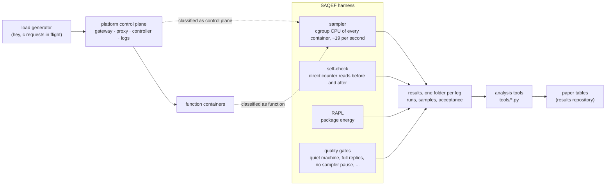

# SAQEF: a Sustainability-Aware QoS Evaluation Framework for serverless platforms


**How much CPU, energy and carbon does a serverless platform spend on each request, beyond the
function itself?** No platform reports it. SAQEF measures it.

A serverless platform runs a **control plane** beside every function: a gateway that receives the
request, proxies that pass it on, controllers that add and remove containers, and loggers. It runs on
the same CPUs as the functions, yet its cost per request is invisible. SAQEF separates the platform's
CPU time from the function's, container by container, checks its own totals against the kernel on
every run, and reads energy from the processor's own meter (Intel RAPL).

- **Sustainability-aware:** CPU time, energy and carbon per request.
- **QoS:** every run also records latency (median and p99), throughput and the share of requests
  answered, so a cost is never read without the service it bought.
- **Evaluation framework:** one command per measurement session, automatic quality checks, and
  experiments whose predictions are written down before any data exists.

---

## What it has found

From a pre-registered study of four open-source platforms on one machine with 8 logical CPUs
(paper in preparation):

| Finding | Numbers |
|---|---|
| The light platforms' control plane is cheap under steady load | OpenFaaS, Fn and Knative: 0.29–0.72 ms of CPU per request, against 5–6 ms for the function |
| OpenWhisk standalone's cost is one log process per request | about 18 ms per request; switching the collector off: 21 → 3 ms, and three times the throughput |
| Its throughput limit is its 2 action containers | with 10 containers, up to 2.4 times the requests per second at a similar control-plane CPU |
| Where the platform's boundary is drawn changes the ranking | counting proxies and wrappers beside the function, OpenFaaS and Fn swap places |
| The cost is not a constant | grows with request size on every platform; +47 % on Fn with a memory-heavy function; +22–23 % on OpenFaaS in bursts |
| Cold starts cost the machine, not the platform | on Fn and Knative, each new container costs 0.23–0.72 s of host CPU, 40–70 times the platform's own share |
| For functions that wait, the platform dominates | the control plane's share of container CPU rises from 4–32 % to 23–82 % |
| No fixed watts per core | one busy core costs 6.6–8.6 W at one request in flight, 3.4–3.6 W at eight |

---

## How it works



1. **Classify.** Every container is marked control plane or function by name, image or label, from
   a fixed list per platform (`platforms/*.py`). Anything on neither list is reported on its own,
   never added to either side.
2. **Sample.** During a run, the sampler reads each container's cumulative CPU counter from cgroup v2.
   Totals are differences of running counters, so they do not depend on the sampling rate.
3. **Check.** Right before and after each run, the control-plane counters are read directly and
   compared with the sampler's total (they agreed within 0.6 % in all 78 steady-load runs).
4. **Gate.** A run is usable only if the machine was quiet, every request was answered, the sampler
   never paused for more than 1 s, the self-check agreed and throughput stayed stable. A failed leg is
   retried once; failing twice, it is reported as missing.
5. **Report.** Per request: control-plane CPU, function CPU, the control plane's share, host CPU
   outside all containers, energy above idle (from a 60 s idle probe after each leg), latency and
   throughput.

---

## Two repositories

| Repository | Visibility | What it holds |
|---|---|---|
| **`saqef`** (this one) | public | The measurement tool: harness, platform adapters, the function code of every experiment, session drivers, analysis tools, unit tests, and the measurement log with every pre-registration and outcome |
| **`saqef-paper`** | private until publication | The paper and its figures, the committed raw results of every session, `VERIFIED_RESULTS.md` (the one file every cited number comes from) and the scripts that turn results into tables and figures |

Clone both side by side; the analysis tools find the results as `../saqef-paper/results`.

```
saqef/                    measurement            saqef-paper/              paper
├── saqef                 CLI                    ├── versions/v10/         the paper, figures, meeting brief
├── saqef_harness.py      harness                ├── VERIFIED_RESULTS.md   every cited number (generated)
├── platforms/            adapters               ├── scripts/              table, figure and paper builders
├── workloads/            functions per test     ├── results/              raw results, one folder per leg
├── tools/                drivers + analysis     └── reviews/              review rounds and responses
├── tests/                unit tests
└── TROUBLESHOOTING_RUNBOOK.md   plans, outcomes, bug ledger
```

---

## Experiments

Each experiment is one measurement session, started by one command. Its design, numeric predictions
and decision rules are written in `TROUBLESHOOTING_RUNBOOK.md` and committed **before** it runs; the
session driver refuses to start an experiment whose plan is not committed.

| Experiment | Question | Function | Command | Runbook |
|---|---|---|---|---|
| Steady load | What does the control plane cost per request, and where does it go? | 5 ms of CPU work | `sudo bash tools/go.sh` | §24, §27 |
| Log collector | How much of OpenWhisk standalone's cost is log collection? | 5 ms of CPU work | `sudo bash tools/go.sh --arm owlog29` | §29 |
| W1 request size | Does the cost grow with request size (1 KiB, 64 KiB, 512 KiB)? | echo the body (`workloads/payload`) | `sudo bash tools/go.sh --workload payload` | §28 |
| W2 memory | Does a memory-heavy function make the control plane dearer? | copy memory for 5 ms (`workloads/mem_*`) | `sudo bash tools/go.sh --workload memory --rerun 2` | §30 |
| W3 bursts | Are bursts of 100 and 500 requests handled, and at what cost? | 5 ms of CPU work | `sudo bash tools/go.sh --workload burst` | §31 |
| W4 cold start | What happens when a burst reaches a platform with no containers? | 5 ms of CPU work | `sudo bash tools/go.sh --workload cold` | §32 |
| W5 waiting | Does the cost depend on whether the function computes or waits? | CPU, sleep, disk write, mixed (`workloads/io_*`) | `sudo bash tools/go.sh --workload io --block A` (and `B2`) | §36 |
| W6 failures and load | Failed calls, overload, half load, mixed traffic, more OpenWhisk containers | `workloads/w6_*` | `sudo bash tools/go.sh --workload fail --block A` (and `A2`, `B`) | §38 |
| Offline analyses | Watts per busy core, energy split by CPU role, latency against CPU, platform fee | none (stored data) | `python3 tools/<tool>.py` | §34, §39, §41 |

A session takes the machine over: it waits until interactive applications are closed, switches to
text mode, runs every leg, and brings the desktop back when done. Progress: `sudo bash tools/go.sh
--status`; stop: `--stop`.

---

## What each file does

### Measurement core

| File | Role |
|---|---|
| `saqef` | Command-line entry point: `check`, `deploy`, `teardown`, `scale`, `verify`, `run`, `gates`, `regression` |
| `saqef_harness.py` | The harness: sampler, container classification, self-check, RAPL reads, quality gates, run records |
| `platforms/base.py` | What every platform adapter provides: deploy, verify, run, teardown, container lists |
| `platforms/openfaas.py`, `fn.py`, `knative.py`, `openwhisk.py` | One adapter per platform: how it is installed, which containers are control plane and which are function |
| `run_saqef.sh`, `run_openfaas.sh` | Stack runners for Fn and OpenFaaS, called by the adapters |
| `metrics/cpubound.json` | The metric recipe the CLI loads |

### Functions

| Path | Role |
|---|---|
| `hello/`, `OF_FUNCTION/`, `KNATIVE_FUNCTION/`, `OW_FUNCTION/` | The deployed function for Fn, OpenFaaS, Knative and OpenWhisk; by default 5 ms of CPU work |
| `workloads/<arm>/` | The function of each other experiment, mirroring the four paths above; swapped in and out by `tools/workload.sh` |
| `OPENFAAS_DEPLOY/` | OpenFaaS Docker Swarm stack (gateway 0.8.3, Prometheus, NATS) |

### Session drivers (`tools/`)

| Script | Role |
|---|---|
| `go.sh` | **The one command per session.** Prepares Docker and Knative, runs the pre-flight checks, starts the driver as a system service, switches to text mode |
| `run_final.sh` | The session driver: pre-flight (power, clock, quiet machine, committed code, load-generator build), legs in order, one retry; `--dry-run` prints the plan |
| `run_lock_session.sh` | One leg: deploy, verify, runs, gates, 60 s idle probe, teardown |
| `workload.sh` | Swap a function in or out, rebuild images, and probe every platform before a session |
| `pool.sh` | Count, empty or log a platform's function containers (W4, W6) |
| `jvm_thread_sampler.py` | CPU per thread of OpenWhisk's Java process, to split its control plane by subsystem |
| `plain_docker.py` | The same function in one plain Docker container, no platform: the floor for the platform fee (W5) |
| `screen_status.sh` | Progress on the console while a session runs |
| `run_tier1_conc.sh` | Earlier concurrency driver; kept because the unit tests check gate logic it shares |

### Analysis tools (`tools/`, read stored results, measure nothing)

| Script | Produces | Used for |
|---|---|---|
| `cp_anatomy.py` | Control-plane CPU per component container, and per OpenWhisk thread group | Where the cost goes; W1–W3 |
| `idle_crosscheck.py` | Energy per request on two idle bases (the leg's probe, the session's calibration) | Every energy value |
| `untracked_dyn.py` | Host CPU outside all containers, with the idle level taken out | W1–W3 |
| `cold_analysis.py` | Cold against warm: first-burst replies and delay, CPU per new container | W4 |
| `io_analysis.py` | W5 verdicts and the plain-container fee | W5 |
| `w6_analysis.py` | W6 verdicts, ratios to base, OpenWhisk container test | W6 |
| `energy_linearity.py` | Power against busy cores (no fixed watts per core) | Energy |
| `energy_split.py` | Power split by CPU role (platform, function, outside), judged on left-out sessions | Energy |
| `latency_overhead.py` | Added latency beside added CPU | Steady load |
| `fn_pool_growth.py` | How Fn's container pool grows inside a burst | W3, W4 |
| `ow_host_attrib_ab.py` | Which host process carries OpenWhisk's CPU outside its containers | Log collector |
| `legacy_reattribute.py` | Rebuilds a run's attribution from its raw samples; also checks the classification tolerance | Validation |

### Records

| File | Role |
|---|---|
| `TROUBLESHOOTING_RUNBOOK.md` | Every pre-registration and its outcome, and a bug ledger. Start at its "Index: symptom → section" table |
| `NEXT_STEPS.md` | What is still to run or do |
| `docs/MEASUREMENT_RULES.md` | Rules for running and interpreting a session |
| `docs/OPENFAAS_SETUP.md` | The OpenFaaS Swarm image set and why it is pinned |
| `tests/` | 272 unit tests: gates, parsers, drivers, analysis tools, and numbers quoted in the runbook |

---

## Quick start

**Requirements.** Linux on bare metal with an Intel CPU and readable RAPL
(`/sys/class/powercap/intel-rapl:0`); root for measurement sessions; Docker; k3s with Knative Serving
1.23 and Kourier for Knative; the Fn CLI; `faas-cli`; the OpenWhisk standalone image; the `hey` load
generator; Python 3 with NumPy. `sudo bash setup/setup_baremetal.sh` installs Docker, Go, the Fn CLI,
`faas-cli` and `hey`, and makes RAPL readable.

```bash
# unit tests (no platform needed)
python3 -m unittest discover -s tests -q

# the plan of a session, and whether this machine passes the pre-flight
sudo bash tools/run_final.sh --dry-run

# one platform by hand
python3 saqef check
python3 saqef deploy --platform fn
python3 saqef run --platform fn --concurrency 4
python3 saqef teardown --platform fn

# a full measurement session
sudo bash tools/go.sh
```

Each leg writes `results/<platform>_cpubound_lock_<leg>/`: `runs.json` (one record per run),
`run_N/summary.json`, the raw samples, and `acceptance.json`, which lists the usable runs. Results
are aggregated only over those runs.

---

## Data and paper

The paper, the raw results and the table scripts are in the `saqef-paper` repository, private while
the paper is in preparation and available from the author on request. Commit IDs quoted in the
runbook refer to the development history in which each session ran.

## Status and use

This is research work in progress. The repository is visible so that the work can be followed and
checked by the author's supervisors; it is **not released for public use**. All rights are reserved
(see [`LICENSE`](LICENSE)): please do not copy, reuse or redistribute any part of it without the
author's written permission. A licence for reuse will be added when the work is published.
